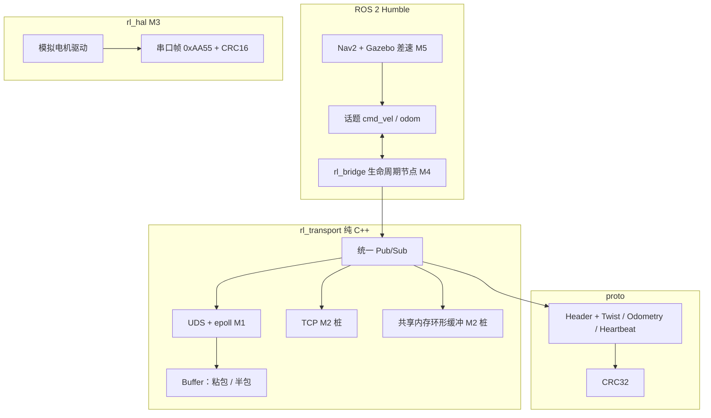

# RoboLink

RoboLink 是一个给 C++ 学生用的机器人中间件练习仓库。目标岗位是机器人中间件工程师：把进程之间的字节流做成可订阅的消息，再和 ROS 2 接上。

目标环境是 **WSL2 + Ubuntu 22.04 + ROS 2 Humble**，语言是 **C++17**。传输层本身不依赖 ROS，可以单独用 CMake 构建。

当前做到 M1：Unix 域套接字上的发布/订阅、长度前缀分帧、Protobuf 和 CRC 已经能跑，测试也在。TCP、共享内存、串口 IO、ROS 桥接只留了能编译的骨架。

## 架构



数据怎么走：

1. 调用方填 `robolink.Twist` 的 seq 和速度。`publish()` 写上墙钟时间和 CRC，再序列化。
2. UDS 发布端在自己的线程里用 epoll 接受连接，把帧写给每个订阅者。没有订阅者时这一帧丢掉，后连上的收不到更早的消息。
3. 帧格式是 **4 字节大端长度 + Protobuf 载荷**。`Buffer` 负责把 read 里切碎的半包拼上，把粘在一起的多帧拆开。
4. 订阅回调拿到载荷后 `decode_message()`：解析失败或 CRC 不对就丢掉。
5. `rl_bridge` 以后把 `geometry_msgs/Twist` 和这条通路对上。现在只在激活时把 UDS 发布端拉起来。

CRC 不算进最终字节里（crc 字段自己会改变序列化结果）。做法是把 `crc32` 清零后序列化，再拼上 3 字节域盐 `RL\x01`，对这段算 IEEE CRC-32。proto3 会省略零值字段，空消息的 CRC 正好是 0，盐用来避免「没签名」也被当成合法。

epoll 用水平触发。套接字暂时写不出去时才关注 `EPOLLOUT`，写完就拿掉，否则线程会空转。

## 目录

```text
proto/                  Protobuf：Header、Twist、Odometry、Heartbeat
rl_transport/           传输层。纯 CMake，也是 colcon 包
  include/rl_transport/ Buffer、CRC、epoll、Pub/Sub
  src/                  UDS 实现；TCP / 共享内存只有 TODO
  examples/             uds_pub_demo、uds_sub_demo
  test/                 分帧、CRC、进程内 UDS 往返
rl_hal/                 串口帧编解码 + 内存里的模拟驱动
docs/hal_frame.md       0xAA55 帧说明
rl_bridge/              ROS 2 生命周期节点骨架
cmake/rl_gtest.cmake    系统没有 GTest 目标时再拉取
Dockerfile              ros:humble 里构建并跑测试
.github/workflows/ci.yml
```

建议阅读顺序：`rl_transport/include/rl_transport/buffer.hpp`，然后 `src/uds_backend.cpp`，然后 `codec.hpp`，最后 `rl_bridge/src/bridge_node.cpp`。串口帧看 `docs/hal_frame.md`。

## 环境

在 WSL2 的 Ubuntu 22.04 里：

```bash
sudo apt update
sudo apt install -y \
  build-essential cmake pkg-config \
  protobuf-compiler libprotobuf-dev \
  ca-certificates curl unzip
```

ROS 2 Humble 按官方文档安装到 `/opt/ros/humble`。只做传输层时可以先不装 ROS。

GTest：CMake 会先找 `GTest::gtest_main`。Ubuntu 22.04 的 `libgtest-dev` 经常没有这个目标，脚本会拉取 googletest 1.14.0。机器需要能访问 GitHub。

## 构建和测试

只构建传输层：

```bash
cmake -S rl_transport -B build/rl_transport -DCMAKE_BUILD_TYPE=RelWithDebInfo
cmake --build build/rl_transport --parallel
ctest --test-dir build/rl_transport --output-on-failure
```

硬件帧：

```bash
cmake -S rl_hal -B build/rl_hal -DCMAKE_BUILD_TYPE=RelWithDebInfo
cmake --build build/rl_hal --parallel
ctest --test-dir build/rl_hal --output-on-failure
```

两个终端里看 UDS 示例。订阅端会重试大约 30 秒，所以谁先启动都行。发布端在没有订阅者时会丢掉当前这一帧，后连上的订阅者看不到更早的消息。

```bash
./build/rl_transport/uds_sub_demo --path /tmp/robolink.sock
./build/rl_transport/uds_pub_demo --path /tmp/robolink.sock --hz 10 --count 100
```

`--count 0` 会一直发，直到 Ctrl-C。发布端退出时会删掉套接字文件。

把整个仓库放进 colcon 工作空间（包就在仓库根目录，不在 `src/` 里）：

```bash
mkdir -p ~/robolink_ws/src
cd ~/robolink_ws/src
git clone https://github.com/foggy111/RoboLink.git
cd ~/robolink_ws
source /opt/ros/humble/setup.bash
colcon build --base-paths src/RoboLink --packages-select rl_transport rl_hal rl_bridge
colcon test --base-paths src/RoboLink --packages-select rl_transport rl_hal --event-handlers console_direct+
colcon test-result --verbose
source install/setup.bash
```

示例也可以用 `ros2 run`。参数放在 `--` 后面，避免被 `ros2` 吃掉：

```bash
ros2 run rl_transport uds_sub_demo -- --path /tmp/robolink.sock
ros2 run rl_transport uds_pub_demo -- --path /tmp/robolink.sock --hz 5 --count 20
```

桥接节点不会自己切状态：

```bash
ros2 run rl_bridge bridge_node
ros2 lifecycle set /rl_bridge configure
ros2 lifecycle set /rl_bridge activate
ros2 lifecycle get /rl_bridge
```

激活之后它会监听参数 `uds_path`（默认 `/tmp/robolink_cmd.sock`）。`cmd_vel` 还没有转发过去。

Docker 镜像基于 `ros:humble`，里面会跑纯 CMake 测试，再跑一遍 colcon：

```bash
docker build -t robolink:humble .
```

套接字还在不在，可以用 `ss -xlp | grep robolink` 看。发布端正常退出时会删掉这个文件。

## 里程碑

| 里程碑 | 状态 | 内容 |
| --- | --- | --- |
| M1 | 进行中 | UDS Pub/Sub、epoll、长度前缀、Protobuf、CRC、示例、测试、CI |
| M2 | 未开始 | TCP 后端；POSIX 共享内存环形缓冲 |
| M3 | 未开始 | 模拟串口电机驱动。帧格式和编解码已经有，串口 IO 还没有 |
| M4 | 未开始 | `rl_bridge` 把 UDS 和 `cmd_vel` / `odom` 打通 |
| M5 | 未开始 | 诊断与心跳、录制回放、Nav2 + Gazebo 差速模型 |
| M6 | 未开始 | ONNX 检测，并和 DDS 做对比 |

- [ ] M1（进行中）UDS、分帧、CRC、示例、Docker 和 CI
- [ ] M2 TCP 与共享内存环形缓冲
- [ ] M3 模拟串口电机驱动
- [ ] M4 生命周期节点桥接 ROS 2 话题
- [ ] M5 诊断 / 心跳、录制回放、Nav2 + Gazebo 差速
- [ ] M6 ONNX 检测，以及和 DDS 的对比

## 基准测试

下面这张表没有任何实测数字。环境还没跑过基准，格子里的 **待测** 就是还没测，不要当成结果。

| 场景 | 指标 | 结果 |
| --- | --- | --- |
| 本机 UDS，小包 Twist | p50 延迟 | 待测 |
| 本机 UDS，小包 Twist | p99 延迟 | 待测 |
| 本机 UDS，单发布多订阅 | 吞吐 | 待测 |
| 共享内存环形缓冲（M2） | 延迟 / 吞吐 | 待测 |
| 对比 Fast DDS（M6） | 延迟 / 吞吐 | 待测 |

测量时请写明：CPU、是否在 WSL2、消息大小、订阅者数量、是否开了 CRC。缺任何一项，数字都不好和别人比。

## 许可证

[MIT](LICENSE)，版权所有 foggy111。
