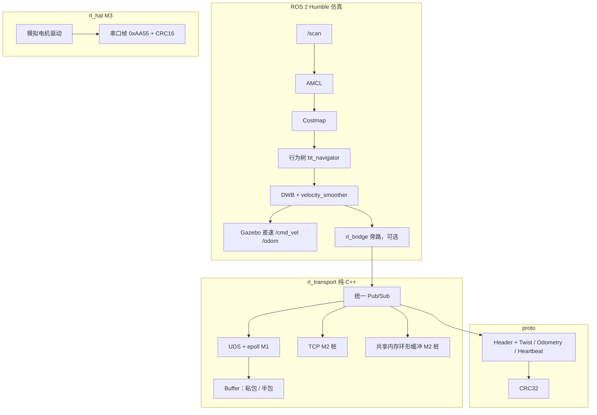

# RoboLink

RoboLink 是一个给 C++ 学生用的机器人中间件练习仓库。目标岗位是机器人中间件工程师：把进程之间的字节流做成可订阅的消息，再和 ROS 2 接上。

目标环境是 **WSL2 + Ubuntu 22.04 + ROS 2 Humble**，语言是 **C++17**。传输层本身不依赖 ROS，可以单独用 CMake 构建。

当前有两块能跑的代码：

- M1：Unix 域套接字上的发布/订阅、长度前缀分帧、Protobuf 和 CRC，测试在。
- 仿真联调：`rl_nav` 用 Gazebo Classic 和 Nav2 把 PPT 里的导航链路接起来。这是仿真，不是真机。

TCP、共享内存、串口 IO 仍是能编译的骨架。`rl_bridge` 会把 `/cmd_vel` 复制到 UDS，并把 UDS 上的里程计解码后发到 `rl_odom`。导航演示不依赖这座桥。分段耗时、控制频率、导航成功率、TF 一致性都还是待测，见 `docs/nav_verification_plan.md`。

人机协作的约定和这次改动里 AI 实际写了什么，写在 `docs/ai_assisted_development.md`。

## 架构



传输层的数据怎么走：

1. 调用方填 `robolink.Twist` 的 seq 和速度。`publish()` 写上墙钟时间和 CRC，再序列化。
2. UDS 发布端在自己的线程里用 epoll 接受连接，把帧写给每个订阅者。没有订阅者时这一帧丢掉，后连上的收不到更早的消息。
3. 帧格式是 **4 字节大端长度 + Protobuf 载荷**。`Buffer` 负责把 read 里切碎的半包拼上，把粘在一起的多帧拆开。
4. 订阅回调拿到载荷后 `decode_message()`：解析失败或 CRC 不对就丢掉。
5. `rl_bridge` 在激活之后把 `geometry_msgs/Twist` 填进 `robolink.Twist` 再 `publish()`。Gazebo 仍然自己订阅 `/cmd_vel`。

CRC 不算进最终字节里（crc 字段自己会改变序列化结果）。做法是把 `crc32` 清零后序列化，再拼上 3 字节域盐 `RL\x01`，对这段算 IEEE CRC-32。proto3 会省略零值字段，空消息的 CRC 正好是 0，盐用来避免「没签名」也被当成合法。

epoll 用水平触发。套接字暂时写不出去时才关注 `EPOLLOUT`，写完就拿掉，否则线程会空转。

## 仿真链路和 PPT 的对应

设计说明在 `docs/nav_simulation_design.md`。对照关系：

| PPT | 仿真里 |
| --- | --- |
| 传感器 | Gazebo 射线传感器发布 `/scan`，坐标系 `laser_link` |
| TF | 差速插件发布 `odom` → `base_footprint`；`robot_state_publisher` 发布足迹、底盘、激光和轮子；AMCL 发布 `map` → `odom` |
| AMCL | `nav2_amcl`，初始位姿 `(0, 0, yaw 0)`，和默认出生点相同 |
| Costmap | 全局、局部两张，静态地图加激光障碍和膨胀 |
| 规划（行为树） | `bt_navigator` 使用安装包自带的 NavigateToPose 行为树，全局规划是 NavFn |
| 控制 | DWB 写出 `cmd_vel_nav`，`velocity_smoother` 发到 `/cmd_vel`。参数里的 `controller_frequency: 20.0` 是设定 |
| 底盘执行 | `gazebo_ros_diff_drive` 订阅 `/cmd_vel`，发布 `/odom`。里程计来自 Gazebo 世界位姿，不是编码器，也不是真车 |

`rl_bridge` 不在这条闭环里。它订阅同一个 `/cmd_vel`，复制到 Unix 域套接字；UDS 上若有 `robolink.Odometry`，解码后发到 `rl_odom`。当前仿真没有进程写那条里程计套接字，所以 `rl_odom` 在联调时没有数据。

## 目录

```text
proto/                  Protobuf：Header、Twist、Odometry、Heartbeat
rl_transport/           传输层。纯 CMake，也是 colcon 包
rl_hal/                 串口帧编解码 + 内存里的模拟驱动
rl_bridge/              cmd_vel 旁路到 UDS，UDS 里程计解码到 rl_odom
rl_nav/                 Gazebo + Nav2 仿真
  launch/sim_nav.launch.py
  urdf/diff_bot.urdf.xacro
  maps/ worlds/         由 scripts/gen_room_assets.py 生成
  config/nav2_params.yaml
  scripts/send_nav_goal
  scripts/collect_nav_metrics
docs/nav_simulation_design.md
docs/nav_verification_plan.md
docs/ai_assisted_development.md
docs/ai_review_notes.md
benchmarks/results/     有真实运行记录才放 JSON。现在是空的
```

建议阅读顺序：`docs/nav_simulation_design.md`，然后 `rl_nav/launch/sim_nav.launch.py`。传输层仍是 `rl_transport/include/rl_transport/buffer.hpp`，`src/uds_backend.cpp`，`codec.hpp`，最后 `rl_bridge/src/bridge_node.cpp`。串口帧看 `docs/hal_frame.md`。

## 环境

在 WSL2 的 Ubuntu 22.04 里：

```bash
sudo apt update
sudo apt install -y \
  build-essential cmake pkg-config \
  protobuf-compiler libprotobuf-dev \
  ca-certificates curl unzip
```

ROS 2 Humble 按官方文档安装到 `/opt/ros/humble`。只做传输层时可以先不装 ROS。

要跑仿真，再装：

```bash
sudo apt install -y \
  ros-humble-gazebo-ros-pkgs \
  ros-humble-robot-state-publisher \
  ros-humble-xacro \
  ros-humble-nav2-bringup \
  ros-humble-rviz2 \
  ros-humble-nav2-msgs
```

### WSL2 的窗口

Windows 11 的 WSLg 里，`echo $DISPLAY` 一般是 `:0`。Gazebo 和 RViz 需要 OpenGL。窗口黑屏、马上退出，或者日志里有 `libGL error` 时，可以先：

```bash
export LIBGL_ALWAYS_SOFTWARE=1
```

然后再启动。这是软件渲染，会更慢，不能拿来当控制频率的成绩。

没有 WSLg、改用 VcXsrv 或 Xming 时，需要自己把 `DISPLAY` 指到当时的 X 服务器（常见是宿主机地址加 `:0`），并允许 WSL 连接。地址以那台机器的 `/etc/resolv.conf` 为准。

无界面启动（机器上仍然要有上面的 apt 包）：

```bash
ros2 launch rl_nav sim_nav.launch.py gui:=false rviz:=false
```

GitHub Actions 里的 `ros:humble` 镜像不装 Gazebo / Nav2，CI 不启动仿真。CI 会编译四个包，并跑传输层测试、桥的转换测试，以及 `python3 rl_nav/test/test_assets.py`。

GTest：CMake 会先找 `GTest::gtest_main`。Ubuntu 22.04 的 `libgtest-dev` 经常没有这个目标，脚本会拉取 googletest 1.14.0。机器需要能访问 GitHub。

## 构建和测试

只构建传输层：

```bash
cmake -S rl_transport -B build/rl_transport -DCMAKE_BUILD_TYPE=RelWithDebInfo
cmake --build build/rl_transport --parallel
ctest --test-dir build/rl_transport --output-on-failure
```

硬件帧：

```bash
cmake -S rl_hal -B build/rl_hal -DCMAKE_BUILD_TYPE=RelWithDebInfo
cmake --build build/rl_hal --parallel
ctest --test-dir build/rl_hal --output-on-failure
```

不依赖 ROS 的仿真资产检查：

```bash
python3 rl_nav/test/test_assets.py
```

两个终端里看 UDS 示例。订阅端会重试大约 30 秒，所以谁先启动都行。发布端在没有订阅者时会丢掉当前这一帧，后连上的订阅者看不到更早的消息。

```bash
./build/rl_transport/uds_sub_demo --path /tmp/robolink.sock
./build/rl_transport/uds_pub_demo --path /tmp/robolink.sock --hz 10 --count 100
```

`--count 0` 会一直发，直到 Ctrl-C。发布端退出时会删掉套接字文件。

把整个仓库放进 colcon 工作空间（包就在仓库根目录，不在 `src/` 里）：

```bash
mkdir -p ~/robolink_ws/src
cd ~/robolink_ws/src
git clone https://github.com/foggy111/RoboLink.git
cd ~/robolink_ws
source /opt/ros/humble/setup.bash
colcon build --base-paths src/RoboLink --packages-select rl_transport rl_hal rl_bridge rl_nav
colcon test --base-paths src/RoboLink --packages-select rl_transport rl_hal rl_bridge rl_nav --event-handlers console_direct+
colcon test-result --verbose
source install/setup.bash
```

示例也可以用 `ros2 run`。参数放在 `--` 后面，避免被 `ros2` 吃掉：

```bash
ros2 run rl_transport uds_sub_demo -- --path /tmp/robolink.sock
ros2 run rl_transport uds_pub_demo -- --path /tmp/robolink.sock --hz 5 --count 20
```

## 答辩演示

两条命令。先完成上面的 colcon，并 `source install/setup.bash`。

终端 1：

```bash
ros2 launch rl_nav sim_nav.launch.py
```

也可以 `rl_nav/scripts/demo_nav.sh up`。无界面时加上 `gui:=false rviz:=false`。

评委会看到：

1. Gazebo 窗口：约 10 m 见方的房间，四面墙，东南侧有一个 0.6 m 的方柱，房间中心有一辆蓝色差速小车，车顶有一个红色激光盒。激光线可以在 Gazebo 里看到。
2. 大约 5 秒后 Nav2 才启动。这是 launch 里的等待，用来等 `/clock` 和模型，不是测到的链路耗时。RViz 固定坐标系是 `map`。AMCL 还没发布 `map` → `odom` 时，RViz 会暂时报这个坐标系不存在，生命周期起来之后应消失。
3. RViz 里应出现栅格地图、红色激光、全局和局部代价地图、粒子、机器人模型。终端里能看到 `map_server`、`amcl`、`planner_server`、`controller_server`、`bt_navigator`、`velocity_smoother` 的日志。

终端 2，等 Nav2 的日志不再刷启动错误之后：

```bash
ros2 run rl_nav send_nav_goal --ros-args -p use_sim_time:=true -p x:=2.0 -p y:=1.0 -p yaw:=0.0
```

或 `rl_nav/scripts/demo_nav.sh goal`。

这条命令向 `navigate_to_pose` 发送地图坐标 `(2.0, 1.0)`、朝向 0。脚本默认最多等 90 秒让动作服务器出现，再最多等 180 秒让动作结束。

- 动作结果是 `SUCCEEDED`：终端打印这个状态，进程退出码 0。RViz 里应出现 `/plan`，Gazebo 里小车朝目标开。判定容差是参数 `xy_goal_tolerance: 0.25` 米，这是设定，不是定位精度。
- 其它状态、拒绝或超时：终端打印实际状态，退出码不是 0。不要把某一次没跑过的演示说成已经成功。

可选的第三步，用来看桥的旁路，不影响上面两步：

```bash
ros2 run rl_bridge bridge_node
ros2 lifecycle set /rl_bridge configure
ros2 lifecycle set /rl_bridge activate
ros2 run rl_transport uds_sub_demo -- --path /tmp/robolink_cmd.sock
```

车在动的时候，订阅端会打出复制出来的 `linear_x` 和 `angular_z`。先激活桥，再开订阅端。订阅端只在启动后大约 30 秒内重试连接。

## 桥的参数

| 参数 | 默认 | 含义 |
| --- | --- | --- |
| `uds_path` | `/tmp/robolink_cmd.sock` | `cmd_vel` 复制出去的套接字 |
| `uds_odom_path` | `/tmp/robolink_odom.sock` | 等 `robolink.Odometry` 的套接字 |
| `odom_topic` | `rl_odom` | 解码后的 ROS 里程计，不占用 Gazebo 的 `/odom` |
| `odom_frame` | `odom` | 消息头的父坐标系 |
| `base_frame` | `base_link` | `child_frame_id` |

激活失败只影响这座桥。`sim_nav.launch.py` 不会启动它。

## 里程碑

| 里程碑 | 状态 | 内容 |
| --- | --- | --- |
| M1 | 已完成主路径 | UDS Pub/Sub、epoll、长度前缀、Protobuf、CRC、示例、测试、CI。TCP / 共享内存不属于这一段 |
| M2 | 未开始 | TCP 后端；POSIX 共享内存环形缓冲。源文件还在，收发会抛异常 |
| M3 | 部分完成 | 0xAA55 帧编解码和内存里的模拟驱动已有测试。串口 IO 没有 |
| M4 | 部分完成 | `cmd_vel` → UDS Twist，以及 UDS Odometry → `rl_odom`，有转换测试。没有放进 Nav2 闭环，仿真也不写 UDS 里程计 |
| M5 | 仿真联调已提供 | Gazebo 差速 + Nav2。诊断、心跳、录制回放、真机都没有 |
| M6 | 未开始 | ONNX 检测，以及和 DDS 的对比 |

## 指标

传输层和导航都没有写进仓库的实测数字。格子里的待测就是还没测。

| 场景 | 指标 | 结果 |
| --- | --- | --- |
| 本机 UDS，小包 Twist | p50 / p99 / 吞吐 | 待测 |
| 仿真导航链路 | 分段耗时 | 待测 |
| 仿真 `/cmd_vel` | 实际发送频率 | 待测 |
| 仿真 NavigateToPose | 成功率 | 待测 |
| 仿真 TF | 变换是否可解析，以及相对模型真值的误差 | 待测 |

采集方法和必须一起保存的环境字段在 `docs/nav_verification_plan.md`。脚本是 `ros2 run rl_nav collect_nav_metrics`。它不修改本文件。`benchmarks/results/` 里现在没有 JSON。

竞赛数据集上的识别率和本仓库无关，这里不引用那些数字。

## 改房间几何

改 `rl_nav/scripts/room_spec.py`，然后：

```bash
python3 rl_nav/scripts/gen_room_assets.py
python3 rl_nav/test/test_assets.py
```

URDF 里的轮距、轮半径，以及 `nav2_params.yaml` 里的 `robot_radius`、`inflation_radius`、AMCL 初始位姿，要和这份常量一起改。测试会核对轮子、半径和生成出来的地图。

## 许可证

[MIT](LICENSE)，版权所有 foggy111。
